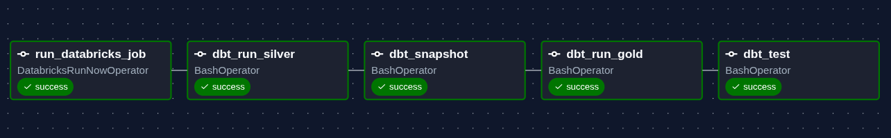
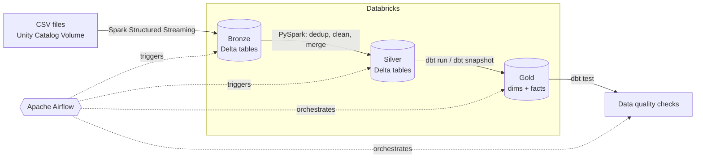
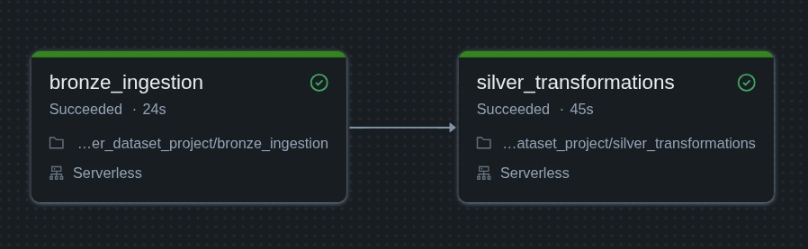

# Uber Data Pipeline

An end-to-end data engineering project that ingests raw Uber-style ride data, refines it through a **Bronze → Silver → Gold** medallion architecture on **Databricks**, models it with **dbt**, and orchestrates everything with **Apache Airflow**.



---

## Table of Contents

- [Overview](#overview)
- [Architecture](#architecture)
- [Tech Stack](#tech-stack)
- [Repository Structure](#repository-structure)
- [Dataset](#dataset)
- [Pipeline Layers](#pipeline-layers)
  - [Bronze: raw ingestion](#bronze--raw-ingestion)
  - [Silver: cleaning and deduplication](#silver--cleaning-and-deduplication)
  - [Gold: analytics-ready models](#gold--analytics-ready-models)
- [Orchestration](#orchestration)
- [Data Quality](#data-quality)
- [Getting Started](#getting-started)
- [Screenshots](#screenshots)
- [Author](#author)

---

## Overview

The pipeline processes six related entities (customers, drivers, vehicles, locations, trips and payments) and turns them into a dimensional model ready for analytics.

Key features:

- **Incremental ingestion** with Spark Structured Streaming (`trigger(once=True)`) and checkpointing, so only new files are processed on each run.
- **Idempotent upserts** into Delta tables using a change-data-capture column (`last_updated_timestamp`), so reruns never create duplicates.
- **Slowly Changing Dimensions (Type 2)** built with dbt snapshots and the `timestamp` strategy.
- **Incremental dbt fact tables** using the `merge` strategy.
- **Automated tests** (not-null, unique, referential integrity) run as the last step of every DAG run.
- **One-click orchestration**: a single Airflow DAG triggers Databricks, then runs dbt end to end.

## Architecture



All data lives in the Unity Catalog catalog `uber_dataset_project`, with one schema per layer: `source`, `bronze`, `silver` and `gold`.

## Tech Stack

| Area | Technology |
| --- | --- |
| Compute & storage | Databricks (serverless), Delta Lake, Unity Catalog Volumes |
| Ingestion & transformation | PySpark, Spark Structured Streaming |
| Modelling & testing | dbt Core with the `dbt-databricks` adapter |
| Orchestration | Apache Airflow 3.3.2 (CeleryExecutor, Redis, PostgreSQL) via Docker Compose |
| Deployment config | Databricks Asset Bundle (`databricks.yml`) |
| Language / tooling | Python 3.12, `uv`, SQL (Jinja) |

## Repository Structure

```
.
├── airflow/
│   ├── dags/
│   │   └── pipeline.py          # The `uber_pipeline` DAG
│   ├── uber_dbt/                # dbt project
│   │   ├── dbt_project.yml
│   │   ├── macros/
│   │   │   └── generate_schema_name.sql
│   │   ├── models/
│   │   │   ├── sources/sources.yml
│   │   │   ├── silver/trips.sql
│   │   │   └── gold/            # fact_trips.sql, fact_payments.sql, schema.yml
│   │   └── snapshots/SCDs.yml   # SCD Type 2 dimensions
│   ├── config/airflow.cfg
│   ├── Dockerfile               # Airflow image + Databricks provider + dbt
│   └── docker-compose.yaml
├── data/                        # Source CSV files
├── notebooks/
│   ├── bronze_ingestion.ipynb   # Streaming ingestion into Bronze
│   └── silver_transformations.ipynb
├── images/                      # Screenshots used in this README
├── databricks.yml               # Databricks bundle definition
├── pyproject.toml               # Python deps (databricks-connect)
└── uv.lock
```

## Dataset

Six CSV files in [`data/`](data/) form the source dataset:

| File | Rows | Key | Notable columns |
| --- | ---: | --- | --- |
| `customers.csv` | 200 | `customer_id` | name, email, phone, city, `signup_date` |
| `drivers.csv` | 50 | `driver_id` | name, phone, `vehicle_id`, `driver_rating`, city |
| `vehicles.csv` | 50 | `vehicle_id` | `license_plate`, `make`, `model`, `year`, `vehicle_type` |
| `locations.csv` | 50 | `location_id` | city, state, country, latitude, longitude |
| `trips.csv` | 1,000 | `trip_id` | driver, customer, vehicle, start/end time and location, `distance_km`, `fare_amount`, `trip_status` |
| `payments.csv` | 1,000 | `payment_id` | `trip_id`, `customer_id`, `payment_method`, `payment_status`, `amount` |

Every table carries a `last_updated_timestamp` column, which drives deduplication, upserts and incremental loads throughout the pipeline.

## Pipeline Layers

### Bronze: raw ingestion

Notebook: [`notebooks/bronze_ingestion.ipynb`](notebooks/bronze_ingestion.ipynb)

- Loops over the six entities, infers each schema from a batch read, then reads the files from `/Volumes/uber_dataset_project/source/source_data/<entity>/` as a stream.
- Writes to Delta tables `uber_dataset_project.bronze.<entity>` in `append` mode with `trigger(once=True)`.
- Uses a checkpoint per entity (`/Volumes/uber_dataset_project/bronze/checkpoints/<entity>`) so files are never ingested twice.

### Silver: cleaning and deduplication

Notebook: [`notebooks/silver_transformations.ipynb`](notebooks/silver_transformations.ipynb)

A reusable `transformations` class provides three building blocks:

- `dedup`: keeps the latest record per key using `row_number()` ordered by `last_updated_timestamp`.
- `process_timestamp`: stamps each row with `process_timestamp`.
- `upsert`: Delta `MERGE` that updates matched rows only when the incoming `last_updated_timestamp` is newer or equal, and inserts new rows.

Entity-specific transformations:

| Entity | Transformations |
| --- | --- |
| Customers | Extract email `domain`, strip non-digits from `phone_number`, build `full_name`, drop `first_name` / `last_name` |
| Drivers | Strip non-digits from `phone_number`, build `full_name`, drop `first_name` / `last_name` |
| Locations | Deduplicate and timestamp |
| Payments | Derive `online_payment_status` (`online-success`, `online-failed`, `online-pending` or `offline`) from method and status |
| Vehicles | Upper-case `make` |

On the first run each Silver table is created; on later runs the notebook merges into it.

The `trips` entity is handled by dbt instead: `models/silver/trips.sql` is an incremental model that reads `bronze.trips` and loads only rows newer than the current maximum `last_updated_timestamp`.

### Gold: analytics-ready models

Built by dbt into the `gold` schema (the custom `generate_schema_name` macro writes models to exactly the schema named in `dbt_project.yml`).

**Dimensions: SCD Type 2 snapshots** ([`snapshots/SCDs.yml`](airflow/uber_dbt/snapshots/SCDs.yml))

| Snapshot | Source | Unique key |
| --- | --- | --- |
| `dim_customers` | `silver.customers` | `customer_id` |
| `dim_drivers` | `silver.drivers` | `driver_id` |
| `dim_vehicles` | `silver.vehicles` | `vehicle_id` |
| `dim_locations` | `silver.locations` | `location_id` |

All use the `timestamp` strategy on `last_updated_timestamp`, and open-ended rows get a `dbt_valid_to` of `9999-12-31`, so history is preserved when a record changes.

**Facts: incremental models (`merge` strategy)**

| Model | Source | Unique key |
| --- | --- | --- |
| `fact_trips` | `ref('trips')` (Silver) | `trip_id` |
| `fact_payments` | `silver.payments` | `payment_id` |

## Orchestration

The [`uber_pipeline`](airflow/dags/pipeline.py) DAG runs five tasks in sequence:

| # | Task | Operator | What it does |
| --: | --- | --- | --- |
| 1 | `run_databricks_job` | `DatabricksRunNowOperator` | Runs the Databricks job (Bronze ingestion, then Silver transformations) |
| 2 | `dbt_run_silver` | `BashOperator` | `dbt run --models silver` |
| 3 | `dbt_snapshot` | `BashOperator` | `dbt snapshot` to refresh the SCD2 dimensions |
| 4 | `dbt_run_gold` | `BashOperator` | `dbt run --models gold` |
| 5 | `dbt_test` | `BashOperator` | `dbt test` |

The Databricks job itself is two serverless notebook tasks, `bronze_ingestion` followed by `silver_transformations`:



## Data Quality

Tests are defined in [`models/gold/schema.yml`](airflow/uber_dbt/models/gold/schema.yml) and run by the final `dbt_test` task:

- `not_null` and `unique` on every primary key (customers, drivers, vehicles, trips, payments).
- `relationships` tests for referential integrity: trips → customers, drivers and vehicles; payments → trips.

## Getting Started

### Prerequisites

- A Databricks workspace with Unity Catalog, a catalog named `uber_dataset_project`, and the schemas `source`, `bronze`, `silver` and `gold`
- A Databricks job that runs the two notebooks in `notebooks/` (Bronze, then Silver)
- Docker and Docker Compose
- Python 3.12 and [`uv`](https://docs.astral.sh/uv/) (only needed for local Databricks Connect development)

### 1. Clone the repository

```bash
git clone https://github.com/youssefamr4800/Uber-Data-Pipeline-Project.git
cd Uber-Data-Pipeline-Project
```

### 2. Load the source data

Upload each CSV from `data/` into its own folder in the Unity Catalog volume, for example `customers.csv` into `/Volumes/uber_dataset_project/source/source_data/customers/`, and so on for the other five entities.

### 3. Configure secrets (not committed to Git)

Create these two files; both are listed in `.gitignore`.

**`airflow/.env`**

```env
FERNET_KEY=<your-generated-fernet-key>
```

**`profiles.yml`** (repo root, mounted into the container at `/opt/airflow/.dbt/profiles.yml`): a dbt profile named `uber_dbt` that points to your Databricks SQL warehouse (host, HTTP path, token, catalog `uber_dataset_project`).

### 4. Point the DAG at your Databricks job

In [`airflow/dags/pipeline.py`](airflow/dags/pipeline.py), replace the `job_id` with the ID of your own Databricks job.

### 5. Start Airflow

```bash
cd airflow
docker compose up airflow-init
docker compose up -d
```

Open the Airflow UI at <http://localhost:8080>.

### 6. Add the Databricks connection

In the Airflow UI, go to **Admin → Connections** and create a connection with ID `databricks_conn` (host and personal access token for your workspace).

### 7. Run the pipeline

Un-pause the `uber_pipeline` DAG and trigger it. The DAG is created paused (`DAGS_ARE_PAUSED_AT_CREATION=true`).

### Optional: local Databricks development

```bash
uv sync
```

installs `databricks-connect` for running notebook code from your IDE. The `databricks.yml` bundle defines a `dev` target for your workspace.

## Screenshots

| Airflow DAG | Databricks job |
| --- | --- |
|  |  |

## Author

**Youssef Amr**: Data Engineer

[GitHub](https://github.com/youssefamr4800)
